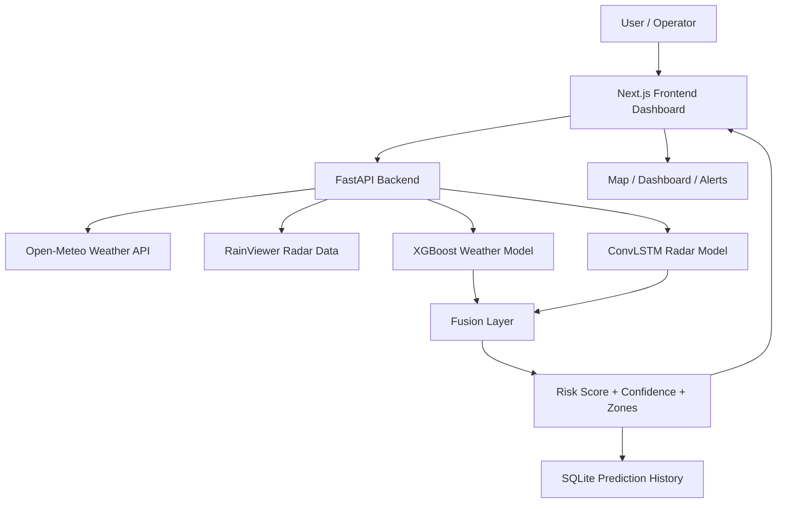
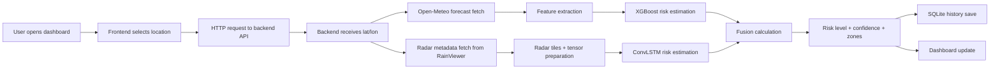
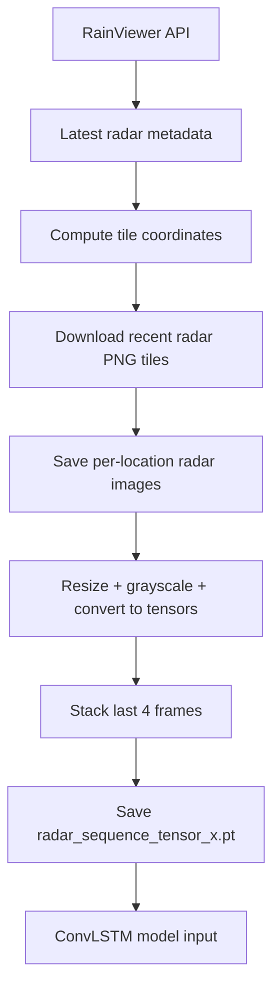

# Project Guide

## 1. Project Overview

This project is an AI-powered thunderstorm and lightning nowcasting system. It is designed to estimate near-term weather risk for a selected location and show the result on a live dashboard.

The system is built for a practical use case: helping users quickly understand whether severe convective weather is likely to develop in the next 30–60 minutes. It brings together real-time weather conditions, radar-derived motion information, and trained ML models to estimate risk in a format that is easy to understand on a dashboard.

At a high level, the project has three key layers:

- a modern frontend dashboard for monitoring and interaction,
- a FastAPI backend that handles requests and model inference,
- an AI/ML stack that processes weather and radar signals to estimate risk.

The platform is especially relevant for disaster response planning, public safety monitoring, and early cautioning in regions exposed to sudden thunderstorm activity.

---

## 2. Simple Project Explanation

If you look at the project in simple terms, it works like this:

1. A user opens the dashboard.
2. The user picks a location such as Ghaziabad or Patna.
3. The frontend asks the backend for the latest weather and risk data.
4. The backend gathers current weather information from an online weather API.
5. It also checks radar-based image data for the same area.
6. The AI models process that information and estimate thunderstorm or lightning risk.
7. The backend combines the model results into a single risk score.
8. The frontend shows the risk level, weather values, map zones, and trend information.

In short, this project turns raw weather inputs into a simple operational risk estimate that can be viewed in real time.

---

## 3. Complete System Architecture

The application uses a classic three-part architecture:

- Frontend: Next.js dashboard for user interaction and visualization
- Backend: FastAPI server for API endpoints and model orchestration
- AI/ML layer: XGBoost + ConvLSTM-based risk estimation pipeline

### High-level architecture



### What each part does

- Frontend: receives the prediction payload, renders weather cards, map overlays, and alerts.
- Backend: handles API requests, models the final output, stores history, and schedules radar sync tasks.
- Weather API: provides real-time atmospheric conditions such as temperature, humidity, and pressure.
- Radar data: provides recent radar image frames that help detect storm motion and severity patterns.
- ML components: process weather conditions and temporal radar patterns to estimate risk.
- Fusion layer: combines the outputs from the two models into a final probability.

---

## 4. Complete Data Flow

The project follows a clean data pipeline from user action to risk output.



### Actual flow in this project

- The frontend does not do heavy calculations; it mostly requests data from the backend.
- The backend decides the geographical location and fetches weather conditions using Open-Meteo.
- It also loads prior radar sequence data or triggers the radar pipeline if enabled.
- XGBoost evaluates atmospheric variables.
- ConvLSTM evaluates the sequence of radar frames.
- The backend fuses the two outputs with explicit weights and produces a final risk score.
- The frontend receives the JSON payload and renders it in dashboard components.

---

## 5. Frontend Guide

The frontend is a single-page operational dashboard built with Next.js and React. Its main responsibility is to show the user a live weather-risk interface.

### Main frontend entry

The primary frontend entry point is:

- [frontend/src/app/page.tsx](frontend/src/app/page.tsx)

This page handles:

- active tab navigation,
- selected location state,
- fetch calls to the backend,
- loading and error states,
- theme toggles,
- map display for risk zones,
- dashboard rendering based on the current section.

### Dashboard structure

The app has a sidebar navigation that includes:

- Dashboard
- Nowcast Map
- Alerts & Notifications
- Data Sources
- Settings

The page also shows quick navigation pills such as:

- Dashboard
- Radar
- Satellite
- Lightning
- Alerts

These map to the actual UI modules that the frontend renders.

### Important UI behavior

The frontend uses the following interaction pattern:

- A location state tracks the selected city and coordinates.
- A risk fetch is triggered when the location changes.
- The app calls two backend endpoints:
  - `/api/realtime-risk`
  - `/api/history`
- The frontend receives a JSON response containing current weather, risk classification, confidence, and map zones.
- The dashboard updates its cards and visualizations from that payload.

### Important frontend components

The project uses a few highly relevant UI components:

- `DashboardView.tsx` — main live risk dashboard, weather cards, model status, trend chart, radar timeline
- `MapComponent.tsx` — map view with risk zones, movement lines, rainfall/radar layers, and location overlays
- `AlertsView.tsx` — alert-focused section for warning visibility
- `DataSourcesView.tsx` — data stream explanation panel
- `SettingsView.tsx` — toggles for theme and radar syncing

### What the dashboard shows

From the actual interface and backend payload, the dashboard includes:

- current weather values such as temperature, humidity, pressure, wind speed
- thunderstorm probability
- lightning probability
- risk level (Low, Moderate, High, Severe)
- forecast window
- confidence percentage
- wind direction and speed
- risk-zone circles on the map
- live radar timeline cards
- predicted trend chart from SQLite history
- AI model status panel
- data source status panel

### Why the dashboard exists

The dashboard turns the backend prediction result into a visual operational interface. It helps a user quickly tell whether a location is currently in a high-risk weather window and what conditions are driving that risk.

---

## 6. Backend Guide

The backend is the core orchestration layer. The main entry point is:

- [backend/main.py](backend/main.py)

### Backend responsibilities

The FastAPI backend does the following:

- loads trained models from the ML folder,
- exposes prediction and history APIs,
- fetches live weather data from Open-Meteo,
- computes a risk score from weather and radar inputs,
- saves prediction history to SQLite,
- optionally runs background radar synchronization.

### Important backend features

#### App initialization

The backend creates a FastAPI app and enables CORS so the frontend can access it locally.

#### Database setup

A SQLite database named `nowcast_history.db` is created automatically if it does not exist. A `history` table stores:

- timestamp
- latitude
- longitude
- thunder probability
- lightning probability

This history is later used by the frontend trend chart.

#### Settings APIs

The backend exposes:

- `GET /api/settings`
- `POST /api/settings/radar/toggle`

These allow the frontend to read and toggle the radar sync configuration.

#### History endpoint

The endpoint `GET /api/history` returns recent prediction values for the selected location.

This data is shaped as a list of objects with:

- time
- thunder probability
- lightning probability

The frontend then plots a recent trend line.

#### Real-time risk endpoint

The main endpoint is:

- `GET /api/realtime-risk`

This is the most important request path. It receives latitude and longitude, then:

1. fetches current weather from Open-Meteo,
2. prepares weather features,
3. uses XGBoost for an atmospheric risk probability,
4. loads radar tensor data for the selected region,
5. runs the ConvLSTM model on the radar sequence,
6. performs a weighted fusion calculation,
7. creates risk levels, confidence, and map zones,
8. saves the result into history,
9. returns the final payload to the frontend.

### Background scheduled tasks

The backend also includes an APScheduler job that runs a radar sync task every 15 minutes when radar sync is enabled.

This scheduler calls functions that:

- download new radar tiles for Ghaziabad and Patna,
- prepare radar tensors for those locations,
- refresh the model input for the next predictions.

### Error handling

The backend is simple but practical:

- it wraps the main risk logic in a `try/except`,
- it raises an HTTP 500 error if the request fails,
- it logs warnings for missing radar models or failed radar preparation.

---

## 7. AI/ML Guide

The project uses a hybrid AI approach rather than one single model. This is a good design for nowcasting because weather risk arises from both atmospheric conditions and moving storm structure.

### A. XGBoost model

The project includes XGBoost training and inference logic.

The training file:

- [ml_models/xgboost_train.py](ml_models/xgboost_train.py)

This model is trained on weather features such as:

- temperature
- humidity
- pressure

It also uses a binary target label representing risk vs non-risk.

In the backend, the model is loaded from:

- `ml_models/xgboost_multi_model.json`

#### Role in the project

The XGBoost model acts as the atmospheric-risk estimator. It interprets the current weather snapshot and outputs a probability-like score representing the likelihood of risky weather conditions.

#### Input

The backend creates a DataFrame with:

- temperature
- humidity
- pressure
- latitude
- longitude

#### Output

It predicts the probability of class 1, which is effectively interpreted as the chance of thunderstorm-risk conditions.

### B. ConvLSTM model

The project also includes a ConvLSTM-based model defined in:

- [ml_models/convlstm_model.py](ml_models/convlstm_model.py)

This model is designed to process a sequence of radar frames instead of only a single image.

#### Why it is used

Radar sequences matter in nowcasting because storm systems evolve over time. A moving storm can look different from one frame to the next. ConvLSTM is well-suited for learning temporal dependencies in image-like data.

#### Input

The preparation pipeline converts radar images into a tensor sequence. The expected shape is:

- batch size
- sequence length
- channel count
- height
- width

The backend loads a radar tensor from files such as:

- `radar_sequence_tensor_ghaziabad.pt`
- `radar_sequence_tensor_patna.pt`

#### Output

The model produces a probability-like risk score between 0 and 1 for the selected region.

### C. Fusion logic

The backend combines the two model outputs using explicit weights:

```python
fused_probability = (xgb_prob * 0.6) + (convlstm_prob * 0.4)
```

This is important because it makes the system more robust than relying on one model alone.

The XGBoost model contributes atmospheric context while the ConvLSTM model contributes spatial-temporal storm evolution. Their combination produces the final thunderstorm risk estimate for the dashboard.

### D. Risk classification logic

The project converts the fused number into a human-readable risk label:

- Severe: > 75%
- High: > 50%
- Moderate: > 25%
- Low: otherwise

This is then shown in the UI and used in alert banners.

### Important reality check

The project clearly demonstrates AI usage, but the architecture is a demonstration-type nowcasting system rather than a fully operational nationwide weather forecasting platform. The backend is organized for model inference, but the data sources and model training are still limited compared to a real production system.

---

## 8. Radar Data Pipeline

Radar data is a central part of this project because it gives the model temporal context for evolving storm conditions.

### Radar workflow

The relevant files are:

- [ml_models/radar_pipeline.py](ml_models/radar_pipeline.py)
- [ml_models/radar_tensor_prep.py](ml_models/radar_tensor_prep.py)

### How it works

1. The system calls the RainViewer weather maps API.
2. It fetches radar metadata and recent timestamps.
3. It calculates the correct tile coordinates for a selected latitude and longitude.
4. It downloads recent radar tiles for the location.
5. These images are saved under a location-specific folder such as:
   - `radar_data_ghaziabad`
   - `radar_data_patna`
6. The tensor preparation step reads the stored images.
7. The images are resized, converted to grayscale, and transformed into tensors.
8. The latest four frames are stacked into a sequence.
9. The processed tensor is saved as a `.pt` file for model inference.



### Why this matters

This is the project’s main sequence-based learning component. Instead of looking at a single weather snapshot, the model can understand how storm patterns change over time.

---

## 9. Weather and External Data Sources

The system uses a small set of external data sources, but they are key to the project’s functionality.

### 1. Open-Meteo

Open-Meteo is used to fetch current weather values for the selected coordinates.

It provides:

- temperature
- humidity
- pressure
- wind speed
- wind direction

This data is used directly in the backend feature vector for XGBoost inference.

### 2. RainViewer radar API

RainViewer is used to fetch radar metadata and image tiles.

It provides:

- radar frame timestamps
- map paths
- tile imagery for location-based weather radar overlays

This data is used to build the sequence-based model input and map overlays.

### 3. SQLite local history

The local database stores previous predictions so the dashboard can show trend data over a short time window.

This is not a primary external source, but it is a major internal data source for UI visualization.

### 4. Local model artifacts

The project stores trained models and tensors locally in the `ml_models` folder.

These files are used directly by the backend during runtime and are part of the inference pipeline.

---

## 10. Technology Stack

| Technology / Library | Category | Purpose in this Project | Why It Is Used |
|----------------------|----------|------------------------|----------------|
| Next.js | Frontend framework | UI application shell | Provides the dashboard app foundation |
| React | Frontend library | Component-based interface | Builds the dashboard and interactive pages |
| TypeScript | Frontend language | Structured UI development | Improves maintainability and safety |
| Leaflet | Mapping library | Map rendering | Draws location markers and risk overlays |
| React Leaflet | React mapping | Map component integration | Connects Leaflet to React UI |
| FastAPI | Backend framework | API server | Handles route requests and model dispatch |
| Python | Backend / ML language | Core logic and model inference | Powers backend logic and model execution |
| Uvicorn | ASGI server | Runs the backend | Serves the FastAPI app |
| XGBoost | ML library | Atmospheric risk model | Classifies weather risk from structured features |
| PyTorch | Deep learning library | ConvLSTM model execution | Runs radar sequence inference |
| Torchvision | Computer vision support | Radar image transform pipeline | Resizes and converts radar images |
| Pandas | Data processing | Editing and preparing feature data | Used in model feature creation |
| Requests | HTTP client | External API access | Retrieves weather and radar metadata |
| APScheduler | Scheduling | Background radar sync | Automates periodic refresh tasks |
| SQLite | Database | Stores prediction history | Powers trend chart and recent risk history |
| Open-Meteo | External API | Weather telemetry | Supplies current atmospheric conditions |
| RainViewer | Radar service | Radar images / map tiles | Supplies frame-based radar information |
| Recharts | Charting | Trend visualization | Draws thunderstorm/lightning trend graphs |
| Lucide React | UI icon library | Dashboard visuals | Adds icons across the app |

---

## 11. Real vs Calculated vs Proxy vs Static

This is an important distinction because some parts of the system are genuinely live, while others are estimates or UI-level simplifications.

| Category | Examples in this Project | Notes |
|----------|-------------------------|-------|
| Real live data | Open-Meteo weather values, RainViewer radar metadata/tiles, selected coordinates, SQLite stored predictions | These are actual runtime inputs or runtime-saved data |
| Actual trained-model predictions | XGBoost atmospheric risk estimate, ConvLSTM radar sequence estimate | These are direct model outputs and are clearly part of the inference path |
| Calculated values | fused probability, risk level thresholds, confidence score, lightning probability, map zone generation | These are computed inside the backend logic |
| Proxy / heuristic values | storm movement direction, estimated arrival, forecast window label, fixed map zone offsets | These are not precise meteorological models; they are practical approximations |
| Static / UI-level simplifications | some layer toggles, fixed location switching between two cities, generic alert copy, chosen map style settings | Useful for demo experience but not a full production system |

### Important note

The project is a strong demonstration of an end-to-end nowcasting idea, but it still contains several computed or heuristic estimates rather than a fully validated production forecast pipeline.

---

## 12. End-to-End Example

Here is a realistic example of how the system behaves in practice.

### Example: user opens the dashboard for Ghaziabad

1. The frontend loads the dashboard and sets the default location to Ghaziabad.
2. It sends a request to `/api/realtime-risk` with latitude and longitude.
3. The backend fetches the current weather from Open-Meteo.
4. It prepares a feature vector with temperature, humidity, pressure, latitude, and longitude.
5. It runs XGBoost and gets a weather-based risk probability.
6. It loads the latest radar tensor for the selected region and runs ConvLSTM.
7. The backend combines both probabilities using a weighted fusion formula.
8. It creates a risk level such as Moderate or High.
9. It computes lightning probability, confidence, risk zones, and storm movement metadata.
10. It saves the result into the SQLite history table.
11. The frontend receives the JSON payload and updates the dashboard cards, trend chart, map, and alerts.

This is the main operational path of the application.

---

## 13. File Structure Explanation

The project structure is intentionally simple and focused on the application lifecycle.

```text
sih-nowcasting/
├── backend/
│   ├── main.py                 # FastAPI server and core prediction logic
│   ├── nowcast_history.db      # Local SQLite database for prediction history
│   └── __pycache__/            # Python runtime cache
├── frontend/
│   ├── src/
│   │   ├── app/
│   │   │   ├── page.tsx        # Main frontend dashboard entry
│   │   │   └── globals.css     # Base styles
│   │   └── components/
│   │       ├── DashboardView.tsx
│   │       ├── MapComponent.tsx
│   │       ├── AlertsView.tsx
│   │       ├── DataSourcesView.tsx
│   │       └── SettingsView.tsx
│   ├── package.json            # Frontend dependencies and scripts
│   ├── next.config.ts          # Next.js config
│   ├── tsconfig.json           # TypeScript config
│   └── public/                 # Static frontend assets
├── ml_models/
│   ├── convlstm_model.py       # ConvLSTM architecture definition
│   ├── convlstm_weights.pth     # Trained ConvLSTM weights
│   ├── xgboost_model.json       # Weather model artifact
│   ├── xgboost_multi_model.json # Multi-location XGBoost model artifact
│   ├── radar_pipeline.py        # Radar tile downloading and saving
│   ├── radar_tensor_prep.py     # Converts radar images to tensor sequence
│   ├── radar_data_ghaziabad/    # Radar data for Ghaziabad
│   ├── radar_data_patna/        # Radar data for Patna
│   ├── labeled_weather_data.csv # Training data for weather model
│   ├── multi_region_train.py    # Multi-region training workflow
│   ├── xgboost_train.py         # XGBoost training logic
│   └── data_labeling.py         # Weather labeling logic
├── README.md                   # Root project documentation
├── PROJECT_GUIDE.md            # Beginner-friendly architectural guide
├── pyrightconfig.json          # Type checking config for Python
├── requirements.txt            # Backend Python dependencies
├── .gitignore                  # Git ignore file
└── venv/                       # Local Python environment
```

This is the important structure needed to understand the project. The focus is on the application flow rather than generated dependency folders.

---

## 14. How to Run the Project

### Backend setup

From the root directory:

```bash
python -m venv venv
venv\Scripts\activate
pip install -r requirements.txt
```

Then start the backend:

```bash
cd backend
uvicorn main:app --reload
```

The backend is expected to run on:

```text
http://127.0.0.1:8000
```

### Frontend setup

From the root directory:

```bash
cd frontend
npm install
npm run dev
```

The frontend is typically served on:

```text
http://localhost:3000
```

### Typical working flow

- Start the backend first
- Start the frontend second
- Open the dashboard in the browser
- Select a location or use the default monitored city
- Watch the risk metrics update

---

## 15. How to Explain This Project to Someone Else

### Simple explanation for a beginner

This project is a weather risk dashboard that uses AI to guess whether a thunderstorm or lightning event is likely in the near future. It collects current weather data, radar information, and model predictions, then shows the information in a simple web dashboard.

### Simple explanation for a technical person

This is a full-stack nowcasting prototype that combines a Next.js frontend, FastAPI backend, XGBoost atmospheric classifier, and ConvLSTM radar-sequence model. It computes a fused thunderstorm-risk score based on live weather and radar signals and renders it in a monitoring dashboard.

### Simple explanation for a judge or evaluator

The project demonstrates an end-to-end AI-driven weather risk system. It integrates data collection, model inference, backend orchestration, and an operational dashboard to present near-term severe weather risk in a user-friendly way.

---

## 16. Current Limitations

The project is useful and functional as a demonstration, but several realistic limitations should be acknowledged:

- It monitors only a small set of locations, mainly Ghaziabad and Patna.
- The user experience is centered around fixed demo locations rather than a general geocoded search system.
- The radar automation is optional and depends on backend settings toggling.
- The weather forecasting is still a risk estimation system, not a full production-grade forecasting engine.
- The storm motion values and some UI-level indicators are approximations rather than highly validated meteorological outputs.
- The dataset and model configuration are still limited compared with large-scale weather operations.
- There is no large operational alerting foundation such as SMS, email, or real emergency dispatch integration.

---

## 17. Future Improvements

The current project provides a solid foundation for a more robust disaster-warning system. Recommended improvements include:

- broader geographic coverage across more cities and districts,
- integration with more authoritative weather and radar datasets,
- larger and more diverse labeled training data,
- actual lightning event datasets for better lightning prediction capability,
- better geospatial search and user-defined location selection,
- stronger alerting and notification flows,
- longer historical trend data for model evaluation and strategy tuning,
- integration with official weather or disaster management APIs,
- more advanced model retraining pipelines and monitoring.

---

## 18. Final Summary

This project is a practical AI-based weather nowcasting system built to estimate thunderstorm and lightning risk in near real time. It combines a React/Next.js dashboard, a FastAPI backend, atmospheric weather inputs, radar sequence analysis, and ML model fusion to create a clean, understandable monitoring tool.

The design demonstrates the full cycle of a modern forecasting product:

- data collection,
- feature extraction,
- modeling,
- data fusion,
- user visualization,
- and decision support.

It is a strong demonstration of how AI can be applied to weather risk detection in a way that is understandable to both technical users and non-technical decision-makers.
